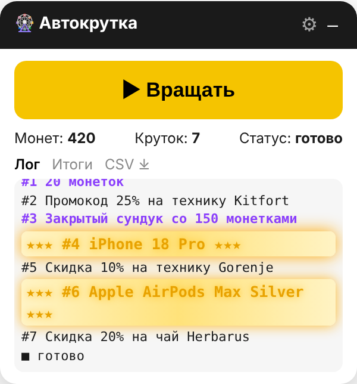
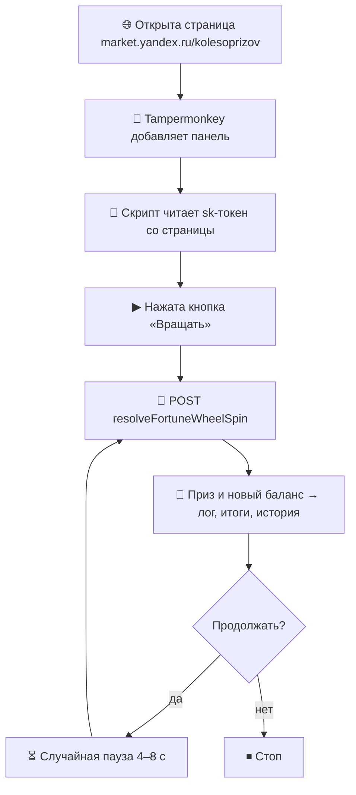

<div align="center">

# 🎡 yaludoman

**Автокрутка «Колеса призов» Яндекс Маркета в один клик**

Userscript для Tampermonkey: накопленные монетки тратятся сами,
без ручных кликов и ожидания анимации.


**[⬇ Установить](https://raw.githubusercontent.com/pafty/yaludoman/main/yaludoman.user.js)**
· [Как работает](#-как-работает) · [Возможности](#-возможности) · [Безопасность](#-безопасность)



</div>

---

## 🚀 Установка

1. Установите расширение **[Tampermonkey](https://www.tampermonkey.net/)**.
2. В Chrome откройте `chrome://extensions` → Tampermonkey → «Сведения» →
   включите **«Разрешить пользовательские скрипты»**.
3. Нажмите **[Установить yaludoman](https://raw.githubusercontent.com/pafty/yaludoman/main/yaludoman.user.js)** → «Установить».
4. Откройте **[Колесо призов](https://market.yandex.ru/kolesoprizov)** — панель появится в правом нижнем углу.

> [!TIP]
> Скрипт обновляется сам. Проверить обновления вручную: меню Tampermonkey → «Проверить обновления скриптов».

---

## ⚙️ Как работает



Скрипт останавливается сам, если:

- достигнуто заданное число круток;
- монет осталось меньше, чем нужно для крутки (с учётом резерва);
- сервер вернул ошибку или попросил обновить страницу;
- вы нажали **«⏹ Стоп»**.

---

## ✨ Возможности

| Возможность | Как реализовано |
|---|---|
| 🎡 Автоматические вращения | До 100 за запуск по умолчанию |
| ⏳ Интервал между крутками | Случайный, 4–8 секунд |
| 🪙 Резерв монет | Можно оставить неснижаемый остаток |
| 📊 Учёт призов | Вкладка «Итоги»: сколько раз выпал каждый приз |
| 🌈 Выделение редких призов | Цветовая классификация в логе |
| 💾 Экспорт результатов | CSV: время, приз, ID, баланс |
| 🔧 Сохранение настроек | `localStorage` браузера |
| 🖱 Управление | Вращать / стоп, сворачивание, перетаскивание панели |
| 🔇 Тихая консоль | Глушит запросы аналитики `clck`, которые режет блокировщик рекламы |

### Редкость призов

| Цвет в логе | Что выпало | Пример |
|---|---|---|
| ⚫ Обычный | Скидки, промокоды, кешбэк | `#2 Промокод 25% на технику Kitfort` |
| 🟣 Фиолетовый | Монеты | `#3 Закрытый сундук со 150 монетками` |
| 🟡 Золотой со свечением | Всё остальное: техника... | `★★★ #4 iPhone 18 Pro ★★★` |

---

## 🔍 Под капотом

Кнопка «Вращать» на сайте отправляет один запрос, а анимация колеса — только визуальный эффект.
Скрипт отправляет тот же запрос, минуя интерфейс:

```js
fetch(API + 'resolveFortuneWheelSpin', {
  method: 'POST',
  credentials: 'include',          // cookies вашей текущей сессии
  headers,                         // в т.ч. sk-токен со страницы
  body: JSON.stringify({
    path: '/kolesoprizov',
    params: { wheelId: 'default_wheel' }
  })
});
```

Ответ сервера сразу содержит приз и новый баланс — их скрипт и показывает в панели.

> [!IMPORTANT]
> Скрипт **не генерирует выигрыши и не влияет на вероятность выпадения призов**.
> Результат каждой крутки определяет сервер Маркета — ровно так же, как при ручном нажатии.

---

## 🔒 Безопасность

- Работает **только** на странице `market.yandex.ru/kolesoprizov`.
- Использует уже открытую сессию браузера — логин и пароль не нужны.
- **Не хранит и никуда не отправляет** токены, cookies или личные данные.
  Все запросы идут только на сам Маркет.
- В `localStorage` сохраняются только настройки панели.
- Код открыт — его можно прочитать целиком в [`yaludoman.user.js`](yaludoman.user.js).

---

## ⚠️ Отказ от ответственности

> [!WARNING]
> Проект неофициальный и не связан с Яндексом. Используйте на свой риск.

- Перед использованием ознакомьтесь с [условиями акции](https://promo-rules.s3.yandex.net/koleso-prizov-rules.pdf).
- Не убирайте паузы между крутками.
- Призы-скидки обычно действуют 24 часа.
- Если Маркет изменит API, скрипт перестанет работать до обновления.

---
